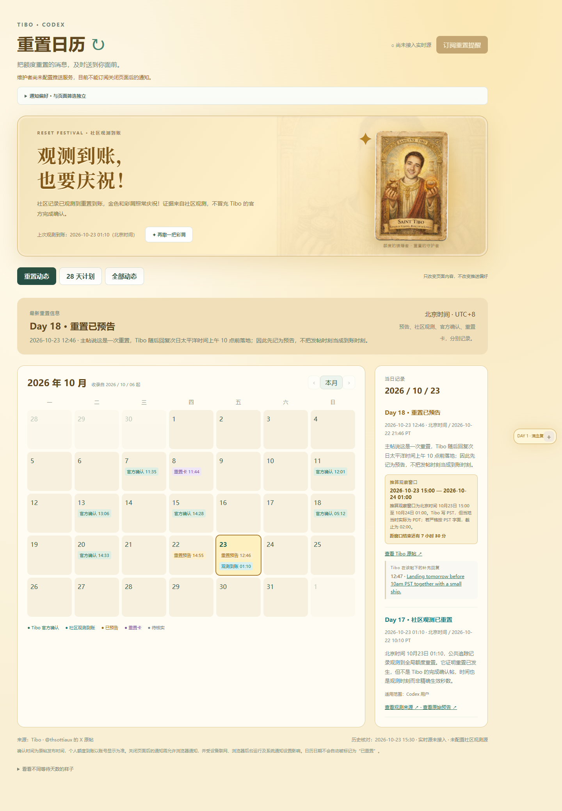
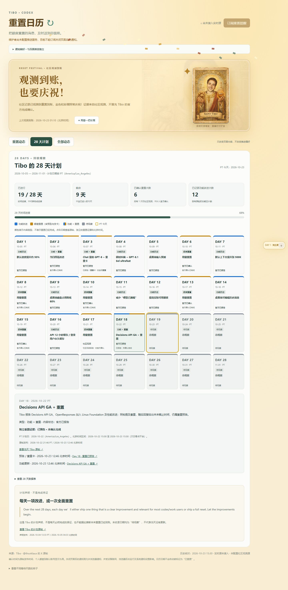

# Tibo Reset Live · OpenAI Codex 额度重置追踪器

Tibo Reset Live 是一个可在用户自己电脑运行的 OpenAI Codex 额度重置追踪器。它提供中文重置日历、Tibo 28 天计划、Windows 桌面提醒、重置狂欢页面和人物等待状态，无需登录 X，也不要求仓库作者提供公共服务器。
> No-login OpenAI Codex usage-limit reset tracker and Tibo 28-day plan calendar, with Windows desktop notifications and a self-hosted Node.js option.

下载代码后双击 `start.cmd`，在自己的电脑运行中文重置月历、28 天计划、金色狂欢和人物五阶段。默认从公共 JSON 源定时收录 Tibo 的原帖与回复，无需 X 账号、Cookies、API Token、Telegram 或云服务器。提醒使用本机系统通知，关闭网页后由后台进程继续检查。

公共源由第三方维护，仍需联网，可能延迟、遗漏或中断，不能保证秒级或完整覆盖；页面显示本机检查时间、上游更新时间、最新收录帖时间和错误。可选官方 X API / 云端 Web Push 保留。

## 界面预览

### 重置日历与金色狂欢

保留重置月历、证据分类、双时区详情和“再撒一把彩屑”。官方确认与社区观测都可以庆祝，但页面会明确区分来源，不把预告当作重置完成。



### Tibo 的 28 天计划

独立展示 28 个 PT 计划日、功能与重置类型、时间进度、来源链接，以及尚未收录的待观察日期。



> 截图基于 2026-10-23 演示时已收录的数据，不代表当前实时状态。时间进度不是完成率，计划声明和预告也不等于重置已到账。
> 截图内沿用的人物素材与原图片适用相同的版权限制，详见 [图片来源说明](public/assets/README.md)。

## 当前状态

- 本地免登录源已实际读取验证，包含主帖、回复、原文、UTC 时间和父帖 ID；系统通知可在页面点击测试。真实 X 长连接与公网 Web Push 尚未完成端到端验收。
- `resources/history.json` 保留原有 10 条重置历史；`resources/plan-data.json` 独立维护计划声明、18 个已绑定原帖的计划日及核实发布时间。历史回填不发通知。
- 未配置 X 时自动使用公共源；公共源故障时明确显示异常，继续保留历史，不伪装为实时连接。
- Node.js 24.15+（24 LTS）或 26+；Windows 启动器可自动下载并校验便携 Node 24，无需管理员安装。SQLite、日志和偏好位于 `data/`，不可上传。

## 本地启动

Windows 解压或克隆项目，双击 `start.cmd`。首次需要联网下载依赖；没有兼容 Node 时从 nodejs.org 下载便携运行时，并按官方 SHASUMS256.txt 校验 SHA256。启动器会检查重复进程、选择空闲端口并打开本地日历。打开后点击“开启本机桌面提醒”，按需选择通知类别；在“数据来源与后台状态”内点击“发送桌面测试通知”。

| 文件 | 用途 |
| --- | --- |
| `start.cmd` | 启动或重新打开本地日历，后台进程隐藏运行 |
| `start-service.cmd` | 一次设置当前用户登录后自动启动，并立即拉起后台和日历 |
| `stop.cmd` | 停止本项目后台，保留日历和偏好 |
| `enable-autostart.cmd` | 可选：添加当前用户登录后启动的快捷方式 |
| `disable-autostart.cmd` | 移除本项目的登录启动快捷方式 |

首次启动不会自行添加登录启动项。停止脚本校验项目路径、进程 ID 和启动时间，不会停止其他 Node 项目。关闭网页不停止后台；关机、休眠、断网或源故障期间无法持续监测。恢复后补查可见记录，仅对最近 6 小时的新记录提醒，首次读取及旧记录不群发。勿扰模式、系统通知设置和平台通知支持会影响弹窗展示。

启动器现在运行用户级后台守护：工作进程异常退出时按退避间隔自动拉起，无需管理员安装 Windows 系统服务。`stop.cmd` 会一并停止本项目守护及其工作进程。`start-service.cmd` 只有在使用者主动双击时才写入当前用户的登录启动快捷方式；登录后自动运行，不会在尚未登录或电脑关闭时监测。

记录、源读取游标、通知开关和类别均持久化到 `data/calendar.sqlite`。正常关机、重启、停止和重新启动不会清空；人物会按真实经过的时间继续计算，预告仍会保留。更新代码时保留原来的 `data/` 目录；换到一个全新的项目副本会使用新副本自己的数据。

已有 Node 的用户也可运行：

```sh
npm ci
npm run local
```

本地入口只绑定 `127.0.0.1`，不开放给局域网。本地模式不需要 VAPID 或 HTTPS；提醒类别和开关保存在本机 SQLite，与页面筛选独立。`npm run local` 默认地址为 http://localhost:8788；双击启动器遇到占用会在 8788–8808 中选择空闲端口，打开时请使用启动器显示的 localhost 地址。

Linux/macOS 可用 `npm run local`（通知分别依赖桌面会话与 `notify-send` / 系统通知）；一键脚本当前针对 Windows 验证。高级用户配置 `.env`：`SOURCE_MODE=auto`（默认）会在有 `X_BEARER_TOKEN` 时选择官方源，否则选择公共源；`public` 固定使用公共源，`api` 只用官方接口。

## 项目目录

普通使用者从根目录双击启动即可，开发文件按用途归档：

```text
tibo-reset-live/
├─ src/                 后台、消息分类、通知与数据库代码
├─ public/              网页、样式与人物图片
├─ resources/           项目自带的历史记录与 28 天计划
├─ tests/               自动测试（browser/ 内为浏览器检查）
├─ scripts/             Windows 启动、停止与自启动脚本
├─ docs/                文档与展示截图
├─ README.md            使用说明
├─ package.json         运行命令与依赖
├─ start.cmd            双击启动
├─ start-service.cmd    启动并设置登录自启动
└─ stop.cmd             停止后台
```

`.env.example`、Docker 配置及登录自启动开关也保留在根目录。运行后生成的 `data/`、`.runtime/`、`node_modules/` 和 `.artifacts/` 均不提交 GitHub。`resources/` 是随项目分发的资料，个人新增记录和提醒设置仍保存在根目录的 `data/calendar.sqlite`，升级时请保留 `data/`。

## 免登录公共数据源

默认地址：[codex-reset.com/api/feed](https://codex-reset.com/api/feed)。这是第三方公开收录接口，程序只读其 `tweets` 内的原文、发布时间、账号和父帖关系；不采用它的 `confirmed`、信号评分或“已到账”判断。通过本项目自己的分类器区分功能、预告、完成和发卡，并保留原帖与收录源链接。收录的原文未经本项目独立核验，不等于直接通过官方 API 验证。

- 默认每 120 秒检查，使用 ETag 条件请求，不重叠发起轮询，最短限制 60 秒。通过 `PUBLIC_POLL_SECONDS` 调整。
- `fetched_at` 是上游检查时间，最新原帖时间不是检查时间；用户长时间没发帖不等于源已故障。
- 上游标记 stale 或检查时间落后 15 分钟时显示过期，静默保留记录，不推送这些记录。
- 第一次成功读取只建立基线；后续按原帖 ID 去重，新补录的旧帖不群发。回复缺失父帖信息时不猜测 Done 的含义。
- HTTP 429、断网、格式改变或错账号均显示异常；不会把失败解释成“没有新帖”。
- `PUBLIC_FEED_URL` 可换为相同结构的可信 HTTPS JSON 源。这个功能依赖第三方服务可用性，你无需运营服务器，但不能保证来源永久可用或原帖发布后立刻同步。
- 探测时 X Syndication 返回 429，公共 RSSHub 路由不可用，FxTwitter 用户接口只返回账号资料，所以它们未被伪装成免登录时间线备用源。

## 三个内容视图

- **重置动态（默认）**：官方确认、社区观测到账、重置预告、重置卡；保留原月历，日期按北京时间分配。待核实记录仍保存，但不混入已发布动态或推送。
- **28 天计划**：独立 28 日网格，功能、重置、功能加重置、待观察。日期按 `America/Los_Angeles`（PT）。
- **全部动态**：计划总览与合并后的功能 / 重置月历。混合帖可有两个主题条目，共用同一原帖，不把功能状态当作重置完成。

页面筛选与通知偏好完全独立。直接打开默认重置视图；切换后会把视图写入 URL，刷新或分享链接仍保留选择。通知中的功能链接会打开全部动态，摘要链接打开对应计划日。

月历不再向前显示无记录的月份；最早可翻到已收录首月，最晚为当前月。计划视图独立覆盖到 11 月 1 日，不受月历翻页限制。

## 28 天计划及来源

周期固定为 **2026-10-05 至 2026-11-01（含首尾），共 28 个 PT 日期**。

原始计划声明：
https://x.com/thsottiaux/status/2106845241357824205

Tibo 声明未来 28 天每天发布明显改进或全面重置。**这只是计划声明，不是每日完成的保证，更不是未来重置已到账的凭据。**

- `resources/plan-data.json` 存储 `day`、`date`、`plannedType`（feature/reset/feature_reset/upcoming）、`status`（planned/reported/confirmed/observed/pending）、`title`、`summary`、`sourceUrl`，有真实原帖时另带 `sourceAt`。
- 回填功能原帖链接经公开索引定位，再通过 FxTwitter 公共镜像核对作者、文本与发布时间；每条显示 Tibo 原帖，不把截图内容直接当作完成数据。运行时来源可选公共 JSON 或官方 API。
- `src/plan.js` 把条目和实时事件合并成 28 日骨架；未来或过去未收录日期都标为“待观察”，不是“当天没有更新”。未来时间戳不参与已记录统计。
- `plannedType` 表示内容类型，颜色不表示完成：蓝色功能、金色重置、蓝金双色混合、灰色待观察；黄色边框是 PT 今天。每格还有文字标签，提供可展开数据表，不只靠颜色区分。
- **已进行 N/28 天**是 PT 日历时间进度（含已进入的今天），不是完成率；剩余天数不含今天。
- **已确认重置次数**只算官方完成证据，按计划日去重，不含发卡、预告、社区观测；仅社区观测另行显示。功能改进按有原帖的功能计划日计数，同日多项只算一天。不能把参考图的数字当作本项目的验证结果。

### PT 与北京时间

计划 Day 按 PT，月历及事件详情按北京时间，详情另列 PT 发布时间。例：Day 18 的帖子是 `2026-10-22 21:46 PT`，对应 `2026-10-23 12:46 北京时间`，并非数据差一天。计划日还显示它对应的北京时间区间。

换算使用 IANA 时区，不固定减 7/8 小时。计划最后一天 11 月 1 日遇到洛杉矶夏令时结束，当地日长 25 小时，测试覆盖这一边界。

## 证据等级、实时收录与回复

事件区分 `topic`（reset / feature / plan）、`evidence` 和 `status`：

| 内容 | topic | evidence | status |
| --- | --- | --- | --- |
| 官方完成确认 | reset | official | confirmed |
| 社区观测到账 | reset | community | observed |
| 未来重置预告 | reset | announcement | planned |
| 重置卡 | reset | official | reported / confirmed（确认的是卡，不是自动重置） |
| 功能发布陈述 | feature | official | reported |
| 每日汇总 | plan | summary | reported（派生摘要，不是新完成证据） |

待核实候选保留 `pending/unverified`，不发推送。功能使用独立 `kind: feature`，绝不塞进 confirmed/scheduled/banked，也不能恢复人物阶段。

- X 规则为 `from:thsottiaux -is:retweet`，保留 Tibo 自己发出的回复，时间线补漏不排除 replies。
- 同主题、同证据层级的回复并入父记录 `followUps`；升级为完成确认的 Done 另记。被合并的多层回复仍可找回主帖上下文。
- 仅从有明确发布陈述的 Day N 帖子识别功能，模糊文本保守处理，可能漏报，不能据此宣称覆盖全部更新。混合帖用 `<原帖ID>-feature` 独立去重。
- 首次 X 启动只回填最近 10 条不群发；之后实时流与每两分钟时间线补漏。帖子 ID 去重，断流重连。不自动合并编辑产生的新 ID。
- “Lands tomorrow before 10am PST” 按洛杉矶当地时区推算观察窗口，并保留严格按 PST 字面计算的备选截止。窗口到点不自动升级完成，不发送到点提醒。

## 金色狂欢与人物五阶段

- **未落地的新预告持续显示金色预热主页**：“重置已宣布，等它落地”，同时列出宣布时间、预告截止和上次完成记录。即使超过 24 小时或预告窗口已过，也继续显示“等待核实”，不退回没有预告的等待室。后续有完成证据才进入正式狂欢。
- **官方确认或社区观测到账后保留 24 小时金色庆祝**，因此北京时间到账当天会一直有金色样式；“再撒一把彩屑”始终可用。不是到午夜就提前撤掉。
- 两者不冒充：官方确认写明官方来源；社区观测显式注明“社区观测到账，非官方完成确认”，光晕较静态，但不撤掉金色和彩屑。
- 人物按最近完成记录经过的完整 24 小时计算 Day 1–Day 5，第五阶段封顶。预告、发卡、功能、待核实不恢复人物、不制造庆祝。
- 底部预览只改外观；无完成记录时显示等待确认；未来时间戳不算完成。窄屏默认收起人物，用户可展开；尊重减少动态效果设置。
- 预览时顶部提示固定可见，人物标签显示“预览”，人物卡内可直接退出；预览不保存成真实状态。
- 计划详情在宽屏与日期网格并排，窄屏放在网格前，点击日期可定位详情；同一原帖不重复展示链接，待观察卡片避免重复状态文字。

## 通知偏好（后台保存）

本机模式保存到当前电脑，通过系统桌面通知投递，不要求浏览器通知权限或 VAPID；云端模式继续使用下述 Web Push 订阅。

| 开关 | 默认 | 覆盖内容 |
| --- | --- | --- |
| 重置已确认 | 开 | 官方完成确认 |
| 社区观测到账 | 开 | 社区观测 |
| 重置预告 / 重置卡 | 关 | 预告及发卡 |
| 功能更新 | 关 | 已收录功能发布陈述 |
| 每日计划摘要 | 关 | PT 每日 18:00 后当日摘要 |

`POST /api/subscribe` 接收标准 PushSubscription 加 `preferences`。偏好持久保存到订阅 JSON；`POST /api/preferences` 用 `{endpoint}` 读取，用 `{endpoint,preferences}` 更新。只接受已知布尔字段。恢复页面时会从服务器读取，不依赖 localStorage。

入队按偏好筛选，实际投递前再次检查最新偏好，避免关闭类别后仍发送旧队列。推送给外部服务时仅发送协议字段，不传偏好。失效订阅 404/410 清理，其他失败持久化重试。至少一次交付，不承诺严格一次；客户端用 tag 合并重复展示。

每日摘要在计划周期内 **PT 18:00 后每分钟检查**，只汇总当日，稳定 ID `digest-YYYY-MM-DD` 防重复。如果程序当天 18:00 后才启动，则静默记下当天，不补发停机期间摘要；次日正常发送。没有历史天数补发，前一 PT 日期遗留的摘要任务也不迟发。摘要只是汇总，不是完成凭据。

## 社区观测源

`OBSERVATION_SOURCES` 默认留空，程序不内置抓取任何第三方站点。部署者可填写逗号分隔的可信 HTTPS JSON 地址：

```json
{"observations":[{"id":"day18-20261023T0100Z","at":"2026-10-23T01:00:00Z","url":"https://example.test/record","note":"说明文字","scope":"Codex 用户"}]}
```

仅完整来源链接、有效时间、最近 7 天、非明显未来的数据入库。ID 去重，失败不影响其他源；可在 API 查看错误和检查时间。观测代表公共追踪的报告，不是官方确认，也不是每个用户都已到账的保证。

## 开源分发与可选云部署

默认分发方式是每个人自行下载、克隆并运行，不需要仓库作者提供公共服务器。`data/`、`.runtime/`、`.env`、用户订阅和日志都留在各自电脑，不上传 GitHub。

想让电脑关闭后仍持续监测的高级用户，可自行部署长期运行的 Node 服务：复制 `.env.example` 为 `.env`，运行 `npm run keys` 并填写两项 VAPID key、维护者邮箱、外部 HTTPS `PUBLIC_ORIGIN`，用 `npm start` 或 `docker compose up -d --build` 启动。官方实时流另需有权限的 X 应用 Token。密钥只留在自己的部署环境，不能共享到仓库。GitHub Pages 无法运行这些后台功能。

云端不暴露本机桌面控制接口。Web Push 受系统、浏览器后台、联网和推送服务可达性影响；部分移动系统需添加到主屏幕。云端接入仍需单独实测。

发布前：
- 检查 `.gitignore`，不提交 `.env`、`data/`、`node_modules/`、凭证或用户订阅。
- 先本地测试，再用维护者自己的设备验收真实 X / HTTPS / 关闭页面后的通知。
- 若自行将实例开放给别人，需加反向代理限流、订阅限制及数据备份；费用由该实例部署者承担。

## 验证

```sh
npm test
npm install --no-save playwright
npm run test:ui
npm run test:festival
npm run test:local
```

浏览器 QA 默认使用 Windows Chrome；`CHROME_PATH` 可为主 QA 指定路径；`QA_BASE_URL` 可指定测试服务地址，例如 Git Bash：

```sh
QA_BASE_URL=http://localhost:8790 npm run test:ui
QA_BASE_URL=http://localhost:8790 npm run test:festival
```

浏览器截图统一输出到 `.artifacts/qa/`，不再散落根目录。`test:local` 自带内存测试服务；`test:ui` 需要固定演示历史和断开实时源的测试服务，`test:festival` 检查 `QA_BASE_URL` 指定的运行实例。

现有 QA 已扩展检查：默认重置视图、三视图切换、28 天网格、数据表、计数、双时区、声明来源、偏好与筛选独立、金色狂欢及彩屑重播、当天 23:59 保留庆祝、人物五阶段、手机/平板无水平溢出、减少动态设置。Node 测试包含日期/DST、通知偏好入库与投递、计划/完成证据分离、实时混合主题与回复链。

真实 X 连接和公网端到端通知仍需配置凭证后由部署者验收，不能把模拟测试通过当作公网验收完成。

## 图片版权与来源

新提供的两张截图只用来参考信息架构及读取待核实线索，**未复制到 public、不嵌入截图、不复刻第三方完整图片或品牌标题**。计划网格使用本项目自己的 HTML/CSS 和经原帖核对的文字摘要。

现有三张圣像/人物图片由需求方提供，继续保留。MIT 只覆盖代码，不代表已经取得图片公开分发授权。**向 GitHub 公开上传前，维护者必须确认图片使用权；无法确认时请替换或移除这些素材。** 详见 `public/assets/README.md`。

## 资料

- X Filtered Stream：https://docs.x.com/x-api/posts/filtered-stream/introduction
- Web Push：https://developer.mozilla.org/en-US/docs/Web/API/Push_API
- 计划声明：https://x.com/thsottiaux/status/2106845241357824205
- 原帖索引参考：https://codexy.fyi/ （索引定位后逐条核对，不直接作为完成证据）

独立社区工具，非 OpenAI 或 X 官方产品。代码许可证：MIT。
