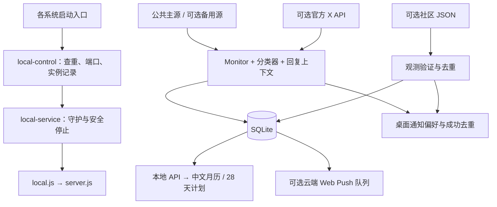

# Tibo Reset Live 开发交接（给 Claude）

> 交接日期：2026-10-25，Asia/Shanghai。本文对应当前本地工作区，不等于 GitHub 上已提交的版本。
>
> 本轮完成代码审阅、隔离验证与交接文档；没有修改业务代码，没有提交或推送。下文的缺陷是待处理项，不是已经修复的功能。

## 1. 先读这里

项目是供用户从 GitHub 下载、自行在电脑上运行的中文 Codex 额度重置日历。作者不提供公共后台。默认不登录 X，不使用 Cookies、Token 或 Telegram；本机后台读取第三方公开 JSON，再通过操作系统发送桌面通知。关闭网页后后台继续工作；电脑关机、休眠、断网时不能实时监测。

当前代码已具备三平台启动入口、用户数据目录、后台守护、免登录轮询、主备源机制、逐源状态、28 天计划和人物五阶段。需要优先处理的两个问题：**功能回复可能归到父帖的旧计划日；桌面通知发送失败后没有自动重试。** 此外有自启环境继承、官方 API 停止期间重试的问题，详见第 9 节。

接手时请保留当前未提交改动、`.env`、用户数据库和偏好；先确认差异，不要用 GitHub 的旧版本覆盖本地代码。提交、推送由用户决定。

## 2. 版本基线与审阅范围

| 项目 | 当前情况 |
| --- | --- |
| 本地目录 | `C:\Users\Administrator\Desktop\weixin\tibo-reset-live` |
| 远程仓库 | <https://github.com/yurenpai/tibo-reset-live> |
| 分支 / HEAD | `main` / `885b196` |
| HEAD 描述 | `重构：整理项目目录，归档源码、测试和历史资料，更新启动路径与使用说明` |
| 运行环境 | Windows，Node.js `v24.21.0`，npm `11.19.0` |
| 声明支持的 Node | `^24.15.0 || >=26.0.0`，不是任意 24.x 或 25.x |
| 文档新增前工作区 | 17 个已有文件修改，11 个 intent-to-add 新文件，13 个未跟踪文件，共 41 个路径 |
| 暂存区 | 没有实际暂存内容；intent-to-add 不代表已经提交或完整暂存 |

审阅覆盖项目自己的后端、前端、CSS、启动与自启脚本、测试、种子资料结构、依赖声明、Docker 和 CI 配置。最终复核基线包含 87 个非忽略文件。没有逐行审计 `node_modules`、第三方依赖源码、图片二进制、私有 `.env` 和用户数据库，也没有在本轮重新向 X 核验全部历史资料。

另一会话修改已纳入：公共主备源、每条来源健康状态、社区源独立重试/取消/去重、频率设置和来源提示；最后出现的 `tests/browser/source-qa.cjs` 也已审阅并通过。

## 3. 产品规则：后续修改不能破坏

1. **预告不等于完成。** 最新未落地预告持续显示“重置已宣布，等它落地”，不能因为时间窗口经过、刷新或重启就退回普通等待室。只有更新的完成证据才改变完成状态。
2. 官方完成、社区观测、未来预告、重置卡、功能发布分开。`banked` 是卡，不是自动到账；即使其 `status` 为 `confirmed`，确认的也只是卡。
3. `confirmed` 表示分类器认为原文是官方完成陈述；若经公共镜像收录，仍需保留 `via`，不能宣称本项目通过官方 API 独立验证过原文。社区观测始终标明不是 Tibo 官方确认，也不保证每个账号均已到账。
4. 默认看重置；另有“28 天计划”和“全部动态”。页面筛选与通知偏好独立，切换视图不能偷偷开启功能通知。
5. 默认通知类别为官方确认、社区观测；预告/重置卡、功能、每日摘要默认关闭。还需用户主动开启本机通知总开关。
6. 完成后庆祝持续 24 小时；官方完整狂欢、社区观测轻庆祝。人物按距最近完成记录的实际时间进入 Day 1–Day 5，第五阶段封顶。功能、预告和发卡不能恢复清晰人物。外观预览不修改真实记录。
7. 28 天计划为 **2026-10-05 至 2026-11-01，按 PT（`America/Los_Angeles`）日期**；月历按北京时间。11 月 1 日 DST 结束，当地日长 25 小时，不能固定加减 24 小时。
8. “已进行 N/28 天”是时间进度；“未收录”不代表当天没更新；计划条目颜色或声明不能生成官方重置完成次数。
9. 首次读取和历史回填静默，不群发旧通知。本机恢复后仅提醒最近 6 小时的新事件。数据库与去重记录必须跨重启保留。
10. 当前免登录路径是分钟级定时检查，第三方也可能延迟、遗漏或中断；不能对外描述成 X 发帖后秒级必达。

## 4. 技术结构与数据流

Node 原生 ESM + Express 5 + `node:sqlite`，前端是原生 HTML/CSS/JavaScript，无打包框架。SQLite 开启 WAL。运行依赖为 `express`、`web-push`、`node-notifier`。



### 后端模块

| 文件 | 作用 / 修改时关注点 |
| --- | --- |
| `src/server.js` | 历史种子、Express API、静态页、安全头、Web Push 投递、PT 18:00 每日摘要、停止流程 |
| `src/local.js` | 本机入口，强制本机模式、绑定 `127.0.0.1`、匹配 localhost Origin |
| `src/local-service.js` | 用户级守护，工作进程退出后退避重启，最长约 30 秒；令牌校验停止，等待子进程退出 |
| `src/paths.js` | 项目与数据目录、旧库迁移；本机和云端默认路径不同 |
| `src/public-feed.js` | 免登录解析、频率预设、ETag、主备切换、逐源冷却、游标、休眠恢复补查 |
| `src/monitor.js` | 串行处理、作者过滤、父帖上下文、多层回复合并；可选官方 API 流与补漏 |
| `src/classify.js` | 否定/预告/完成/发卡/功能分类、事件规范化、Web Push 订阅地址校验 |
| `src/store.js` | SQLite 表与持久化、事件和帖子去重、Web Push 投递队列 |
| `src/desktop.js` | `node-notifier`、通知偏好、系统支持检查、6 小时过滤、成功去重；目前没有持久失败重试队列 |
| `src/observations.js` | 社区 JSON 验证、逐源状态与退避、取消请求、跨源同凭据去重 |
| `src/plan.js` | 28 日骨架、事件归日、静态与动态内容合并、统计；见 R1 |
| `src/preferences.js` | 所有通知类型的统一判定；重置卡归预告开关 |
| `src/schedule.js` | IANA 时区、PT 观察窗口、PST/PDT 字面歧义；窗口不是到账定时器 |

### 前端与布局

| 文件 | 职责 |
| --- | --- |
| `public/app.js` | 月历、筛选、详情、通知和频率表单、主题更新；每 20 秒请求本机 API |
| `public/plan-ui.js` | 28 天网格、统计、详情、数据表与来源；刷新时保留操作焦点 |
| `public/source-status.js` | 来源总览、逐源卡片、主备切换、未配置提示、社区通知说明 |
| `public/content.js` | 前后端共享的内容可见性与日期工具 |
| `public/theme.js` | 真实/预览人物阶段、预告与庆祝状态的纯计算 |
| `public/sw.js` | 可选 Web Push 展示与通知点击，同源地址限制 |
| `public/index.html` | 中文页面结构、脚本与样式入口 |

CSS 加载顺序：`style.css → festival.css → mascot.css → evidence.css → plan.css → local.css → source-settings.css`。`local.css` 与 `source-settings.css` 有重复的来源/频率样式；覆盖还取决于选择器优先级，后文件并非必定胜出。当前自动浏览器检查未发现这些模块在测试宽度下横向溢出，尚未做逐像素人工设计验收。后续改布局建议收敛重复规则，保留手机布局、展开状态、焦点和减少动态效果。

`public/assets/` 人物素材及 `docs/images/` 截图另有来源说明；代码 MIT 许可不代表取得图片的再分发授权，见 `public/assets/README.md`。

## 5. 来源：已经实现什么，尚未接入什么

### 公共帖子源

默认主源为 <https://codex-reset.com/api/feed>。只取原帖 ID、原文、发布时间、账号、链接、回复父帖信息；**不导入上游的 confirmed、评分或运营者判断**。本项目再做分类，并标注“公共镜像收录 · 未独立核验”。

需要的结构：`profile.handle`、`fetched_at`、`tweets[]`；帖子包含 `id/url/at/text`，回复还需 `is_reply/in_reply_to_tweet_id`。账号必须匹配，链接和 ID 必须一致。最多处理前 200 项，响应上限 2 MB；上游检查时间落后 15 分钟或标记 stale 则视为过期，保留记录但不发新通知。

`PUBLIC_FEED_FALLBACK_URLS` 支持最多两个备用 HTTPS 地址，不能含 URL 凭证。主源正常不请求备用；失败、限流、格式错误或过期后依次尝试。各源独立 ETag、缓存、失败次数和冷却；主源冷却结束后优先重试，恢复后切回。同一 X 帖子跨源仍按帖子 ID 去重。

**默认实际只有一个公共源；备用机制可用，不代表存在已验证的第二个服务。** 另一会话的候选核查见 [source-review.md](source-review.md)。其中记录了接口冲突和独立性问题，不能把同源转述算作多份独立证据。该文档的外部探测结果不是本轮重新联网验证的结果。

频率：`smart` 平时 300 秒，最近 48 小时有未落地新预告则 120 秒；`fast` 120 秒、`standard` 300 秒、`saver` 900 秒。约 ±10% 错峰，最短 120 秒，普通失败退避最长约 1800 秒；上游 `Retry-After` 可以要求等更久。48 小时只是加速检查期限，**不是撤销预告的期限**。页面每 20 秒刷新不会额外请求上游。

首次成功读取建立基线；后续仅对新 ID 通知，旧帖补录静默。过期数据不推进成功游标。逐源健康信息目前主要在内存中，进程重启后重新检查；历史事件、游标和设置持久化，不能将两者混为一谈。

### 社区观测源

`OBSERVATION_SOURCES` 默认留空。页面开启“社区观测提醒”不等于自动接入社区数据，也不能凭空观测用户自己的额度。配置地址目前需修改环境后重启，没有页面 URL 编辑器。

接口为数组或 `{ observations: [...] }`，条目至少有 `id/at/url`，可带 `note/scope`。只接受最近 7 天内、最多未来偏差 5 分钟的可核对记录，每次最多检查前 50 项；来源地址要求 HTTPS 且无凭证。事件 ID 加 `observed-` 前缀，保留原凭据和 `via.type=community-feed`。

各社区源分别显示最近检查、成功、失败、下次检查和有效记录数；默认约 5 分钟，失败逐级退避并遵守各自 `Retry-After`，一个源失败不阻塞另一个。停止会中止请求；重复调用不并发。跨源同 `url + at + scope` 的观测不重复提醒，即使提供方 ID 不同。

目前没有经过核实、默认可用的社区实时 JSON 服务。空数组可以表示检查成功但没有有效观测；非空响应全不合格会显示错误，不伪装成功。

### 官方 API 和云端路径

`SOURCE_MODE=auto` 有 Token 选官方、无 Token 选公共；`public` 固定公共，`api` 固定官方。公共模式解析父帖只查当前批次/本地上下文，不偷偷调用需要 Token 的官方 API。

官方模式首次回填最近 10 条且静默；之后实时流和每 120 秒时间线补漏，保留本人回复，过滤转推。需要用户自己的 X Developer App 和相应权限，可能创建过滤流规则。此路径没有在本轮做真实 X 端到端验证，且有 R4。

云端 `npm start`、Docker、VAPID/Web Push 仍保留。它们是可选的用户自部署方式；不能据此承诺本地电脑关机后仍可通知。Web Push 有数据库投递队列，与桌面通知机制不同。

## 6. 启动、自启和持久化

| 系统 | 启动 | 启动并设置登录自启 | 停止 | 取消以后登录自启 |
| --- | --- | --- | --- | --- |
| Windows | `start.cmd` | `start-service.cmd` | `stop.cmd` | `disable-autostart.cmd` |
| macOS | `start.command` | `start-service.command` | `stop.command` | `disable-autostart.command` |
| Linux | `sh start.sh` | `sh start-service.sh` | `sh stop.sh` | `sh disable-autostart.sh` |

Windows `scripts/start-local.ps1` 必要时下载官方便携 Node 24 并校验 SHA256，安装依赖后交给统一控制器。Unix `scripts/start-unix.sh` 要求预装兼容 Node/npm，补充常见 Homebrew PATH，依赖变化时执行 `npm ci`；尚未做 Node 自动下载。

`scripts/local-control.mjs` 加载 `.env`，支持 `start/stop/status/open`：文件锁、默认 8788–8808 端口探测、后台实例记录、健康检查、浏览器打开和安全停止。发现已有存活但暂不健康的后台时，不会盲目再开一个。`src/local-service.js` 是用户进程守护，**不是管理员安装的 Windows Service**。

自启：Windows 当前用户 Startup 快捷方式；macOS LaunchAgent；Linux 优先图形会话 systemd 用户服务，不可用则 XDG autostart。普通启动不会自动写自启项；取消自启设计为不停止当前实例。路径移动后需重新配置；真实登录恢复仍需对应平台验收。

`npm run local` 是直接启动前台，关闭终端就停止；它不受统一控制器管理，`local:status/local:stop` 不能当作管理任意前台进程的工具。本机只监听 `127.0.0.1`，不面向局域网，修改接口需要准确匹配 localhost Origin；不要随意把绑定改成 `0.0.0.0`。

### 数据位置

| 模式 / 系统 | 默认位置 |
| --- | --- |
| Windows 本机 | `%LOCALAPPDATA%\TiboResetLive` |
| macOS 本机 | `~/Library/Application Support/TiboResetLive` |
| Linux 本机 | `$XDG_DATA_HOME/tibo-reset-live`，无此变量则 `~/.local/share/tibo-reset-live` |
| 云端 | 项目 `data/`；Docker 挂载 `/app/data` |
| 显式覆盖 | `TIBO_DATA_DIR` 优先；相对路径从项目根解析 |

SQLite `calendar.sqlite` 的表：`posts`、`events`、`subscriptions`、`deliveries`、`meta`。其中 `deliveries` 是 Web Push 队列，不能当作桌面失败重试已经实现的证据。

主要 meta 键：`desktopSettings`、`desktopSent:<eventId>`、`publicPollMode`、`publicFeedInitialized`、`publicFeedCursor`、官方 `cursor`、`lastCheck`、`observationCheck`、`observationError`。事件正文为 JSON，保留 `topic/evidence/status/kind/parent/followUps/via` 等；混合帖功能事件使用 `<原帖ID>-feature`。

实例文件包括 `local-instance.json`、`local-service.json`、`local-stop.json`、`launcher.lock`，以及日志和迁移记录。令牌用于停止握手，不能公开复制这些运行文件。日志目前没有轮转，属于后续维护事项。

升级旧版时先停止旧后台，再由 SQLite `VACUUM INTO` 建一致快照，包含已提交 WAL；不会直接裸拷贝 sqlite/wal/shm。目标已存在则不覆盖，旧库保留；检测到已知旧后台存活时拒绝迁移。迁移发布用硬链接避免覆盖，实际文件系统兼容性仍值得真机验证。

## 7. 配置与 API 速查

| 配置 | 说明 |
| --- | --- |
| `PORT` | 默认 8788；双击启动器可另选空闲端口 |
| `TIBO_DATA_DIR` | 用户数据目录；临时终端变量与登录自启有 R3 |
| `SOURCE_MODE` | `auto/public/api` |
| `X_BEARER_TOKEN` / `X_HANDLE` | 官方路径凭证与账号，默认账号 `thsottiaux` |
| `PUBLIC_FEED_URL` | 主帖子 JSON 地址 |
| `PUBLIC_FEED_FALLBACK_URLS` | 最多两个备用，逗号分隔，默认空 |
| `PUBLIC_POLL_MODE` | `smart/fast/standard/saver`；数据库已保存选择优先 |
| `PUBLIC_POLL_SECONDS` | 旧配置兼容，映射到安全预设，不是任意秒数 |
| `OBSERVATION_SOURCES` | 社区 HTTPS JSON 地址，逗号分隔，默认空 |
| `PUBLIC_ORIGIN` | 云端外部 HTTPS Origin；本机入口使用所选 localhost Origin |
| `VAPID_PUBLIC_KEY/PRIVATE_KEY/SUBJECT` | 可选云端 Web Push；私钥持久保存，不每次重生成 |

| 接口 | 用途 |
| --- | --- |
| `GET /api/health` | 应用标识、健康、本机模式信息 |
| `GET /api/calendar` | 事件、计划、帖子源状态、逐社区源状态、通知信息 |
| `POST /api/local/preferences` | 保存本机通知总开关和类别 |
| `POST /api/local/test-notification` | 调用系统测试通知，不写重置事件 |
| `POST /api/local/source-settings` | `{pollMode}` 保存预设；不支持随意秒数或地址 |
| `POST /api/subscribe` | 可选 Web Push 订阅 |
| `POST /api/preferences` | 可选 Web Push 订阅偏好 |
| `POST /api/unsubscribe` | 取消订阅和相关投递 |

非 GET API 检查准确的 Origin，并按 IP 限制每分钟 30 次写操作；JSON 上限 8 KB。本机控制接口在没有桌面模块的云部署中不可用。已有 CSP、nosniff 等安全头；这不等于完成公网部署安全审计。

## 8. 已完成的验证及限制

| 验证 | 结果与范围 |
| --- | --- |
| `npm test` | 最终版本 **73/73 通过**；含控制器/守护、路径迁移、计划时区、轮询、主备源、社区状态与分类等 |
| `npm run test:local` | 通过：来源未配置/失败提示、频率保存恢复与草稿、预告持续/完成狂欢、后台通知模拟去重、三视图手机布局等 |
| `qa.cjs` | 隔离的内存数据库、种子与固定后端时间下通过：月历边界、三视图、计划/双时区/统计/偏好、来源隔离、桌面和手机布局 |
| `festival-qa.cjs` | 同一隔离夹具下通过：狂欢、第五阶段、预览退出、人物收起、手机与减少动态效果 |
| `node tests/browser/source-qa.cjs` | 通过：主源 429 后备用状态、独立冷却、社区部分 503、未使用备用状态、手机来源卡片无横向溢出 |
| 脚本语法 | PowerShell AST 解析、Unix `sh -n` 均通过 |
| Windows 实际启动 | 此前开发阶段用临时数据目录验证启动、重复启动、查询与停止；本轮最终 Node 测试也验证共享控制器生命周期。没有再次改动用户当前自启项 |
| R1–R4 定向复现 | 4 个均复现，全部使用内存存储、mock 或配置生成器，不向用户真实系统发通知 |

**尚未证明的内容：** macOS/Linux 真实通知权限、登录自启、睡眠恢复；真实官方 X API 流；公网 HTTPS Web Push；Docker 构建运行；新增 GitHub Actions 的远程结果。CI 配置已写三系统矩阵，但仍是本地未提交文件，不能称为远程三平台验收完成。CI 主要测 Node 与脚本，并不等于操作系统弹窗验收。

### 接手后如何复跑

从项目根运行，先确认 Node 版本与当前工作区：

```sh
git status --short
git diff --stat
node --version
npm ci
npm test
```

浏览器脚本依赖 Playwright，但它目前没有列进开发依赖；临时安装会被后续 `npm ci` 清除：

```sh
npm install --no-save --package-lock=false playwright
npm run test:local
node tests/browser/source-qa.cjs
```

现有脚本默认查 Windows Chrome；`qa.cjs/local-qa.cjs/source-qa.cjs` 可设置 `CHROME_PATH`，`festival-qa.cjs` 仍写死 Windows Chrome，属于跨平台测试待补项。不要因为 Node 的三系统测试存在，就认为浏览器脚本也跨平台。

`test:ui` 和 `test:festival` 需要先有服务器，可用 `QA_BASE_URL` 指定；它们依赖特定历史日期和种子，不宜直接对随时变化的生产数据运行。本轮使用 `Store(':memory:')`、`seedHistoricalEvents`、固定 `now=2026-10-23T09:30:00Z`、随机本地端口的 `createApp`，以异步子进程运行这两个脚本。不要同步阻塞夹具服务器的 Node 事件循环。

本机本轮复核辅助程序在 `.artifacts/handoff/browser-review.mjs` 和 `review-repros.mjs`，可分别 `node` 运行；该目录被 Git 忽略，**不会随仓库交接**，不能将它们当成正式已提交测试。建议后续把有价值的夹具和 R1–R4 回归用例归入 `tests/`，再维护正式测试入口。

真机测试请另设临时 `TIBO_DATA_DIR` 并关闭旧库迁移，例如设置 `TIBO_SKIP_LEGACY_MIGRATION=1`；只停止该临时实例。不要清空默认用户数据目录、冒用用户真实订阅、向真实系统批量发测试消息。

## 9. 审阅发现：待修复问题

以下优先级用于建议开发顺序；R1–R4 已定向复现。它们未计入 73 项现有测试，故“全部测试通过”与“存在缺陷”并不矛盾。

### R1 · P1：功能回复被归入父帖旧日期

- 位置：`src/plan.js:35`，`buildPlan` 内 `eventDay`。
- 原因：所有事件都先沿 `parent` 找计划日，没有先排除功能事件；`monitor.js` 恰好会为功能回复保留 `parent`。
- 最小情景：Day 1 的 reset 预告 `p` 时间 `2026-10-05T20:00:00Z`；其下 Day 2 的功能回复 `f` 时间 `2026-10-06T20:00:00Z`，`topic/kind=feature`、`parent=p`。`dayOf(f.at)` 得到 2，`buildPlan` 却把 `f` 放在 1。
- 影响：功能日、标题与统计可能串日；现有“按 PT 日期而非 planDay”的测试没有跨日父帖，未覆盖此问题。
- 建议：功能先按自身时间归 PT 日；仅为需要关联原预告的重置证据保留父帖归日。不要全局删除父帖逻辑。
- 验收：同日与跨日功能回复、混合帖、跨日 Done 重置关联、循环父帖全部覆盖；修复不能把功能发布时间移动成父帖时间。

### R2 · P1：桌面通知临时失败后不会自动重试

- 位置：`src/desktop.js:43` 的 `event`，结合 `src/public-feed.js` 的成功入库/游标推进。
- 复现：内存 Store 开启桌面提醒，mock `send` 抛临时错误。先成功建立帖子 `100` 基线，再加入新完成帖 `101`，连续检查两次并等待 `desktop.chain`。发送调用只有 1 次；`publicFeedCursor=101`，`desktopSent:101` 未写入，错误保留，但后续不重试。
- 原因：桌面只在内存 Promise 链里尝试；失败被捕获，事件/帖子却已保存，下轮去重跳过，不会再次触发 `event`。重启也没有待发任务扫描，最后错误状态还是内存态。
- 影响：系统通知组件暂时异常时，页面有记录但用户错过弹窗。Web Push 的 `deliveries` 不解决本机路径。
- 建议：为桌面建立可持久化、有次数与退避上限的待发队列；发送时重查偏好和 6 小时有效期，成功后持久去重。首次基线、旧回填和关闭偏好不得进入补发。
- 验收：先失败后恢复可重试；重启后仅补仍有效待发；关闭偏好取消；多次上游轮询/主备切换不重复。系统接口返回接受不代表用户已看见，超时后的最终送达也要考虑去重策略。

### R3 · P2：临时自定义数据目录没有保留进登录自启

- 位置：`scripts/autostart.mjs:12` 起的 `macAgent/linuxUnit/linuxDesktop`。
- 复现：给三个生成器传入 `{env:{PATH:'/usr/bin', TIBO_DATA_DIR:'/tmp/custom-calendar'}}`，生成结果均不含自定义数据目录，只持久化 PATH。
- 条件：用户只在当前终端设置 `TIBO_DATA_DIR` 后启用自启，而没有写入 `.env` 或系统持久环境。
- 影响：下次登录可能改用默认目录，看起来像历史和偏好丢失；实际旧库可能仍在另一目录。生成配置层已复现，真实登出/登入尚未验收。
- 建议：持久化经过解析的目录，或明确要求自定义目录写入 `.env` 并在设置自启时提示。Windows 快捷方式也有临时环境不继承的同类静态风险，尚未真机复现。
- 验收：启用 → 登录恢复 → status → stop 全程使用同一目录，覆盖空格和特殊字符；不能复制凭证等无关环境变量进自启配置。

### R4 · P2：官方 API 初始化退避时停止，等待后还会再请求

- 位置：`src/monitor.js:95` 的 `start` 及其 catch 中 60 秒等待。
- 复现：mock `api` 始终失败，mock `node:timers/promises.setTimeout` 为可控 Promise；第一次失败进入等待后执行 `stop()`，再释放等待。`api` 总调用次数为 2，而不是 1。
- 原因：等待前判断 `!stopped`，等待后直接递归 `start()`；入口没有停止保护。
- 影响：停止后仍可能重新初始化或创建补漏定时器；属于可选官方路径，不是当前默认公共轮询停止问题。
- 建议：可取消等待，入口与关键 await 后检查停止状态，保证停止后不再请求或创建定时器。
- 验收：初始化、回填、规则读取、退避期间分别停止；确认无额外请求、无新 interval，并且正常重连不受影响。

### R5 · P2 候选：Windows 新旧停止路径的目录选择不统一

这是代码审阅推断，**未端到端复现**，不要当作已证实故障。`scripts/stop-local.ps1:3` 在调用共享控制器前先根据终端环境/默认目录找记录，没有在这一步加载 `.env`；若 `.env` 指定新目录、项目 `data/` 恰好残留带 `startedTicks` 的旧记录，可能提前走旧停止分支，没停到新目录的实例。

建议构造隔离的新旧账本测试；优先让共享控制器统一解析路径，再谨慎进入旧版兼容分支。不要为修复此风险按名称杀全部 Node 或删除用户旧库。

## 10. 尚未提交的文件清单

下面是新增本文**之前**的 41 个路径；交接文档本身另算一个新增文件。后续以实时 `git status --short --untracked-files=all` 为准。

### 已有文件修改（17）

```text
.env.example
README.md
package.json
public/app.js
public/index.html
public/local.css
scripts/start-local.ps1
scripts/stop-local.ps1
src/desktop.js
src/local-service.js
src/observations.js
src/paths.js
src/public-feed.js
src/server.js
tests/browser/local-qa.cjs
tests/local-service.test.js
tests/local.test.js
```

### 新文件，已 intent-to-add（11）

```text
disable-autostart.command
disable-autostart.sh
scripts/autostart-unix.sh
scripts/start-unix.sh
scripts/stop-unix.sh
start-service.command
start-service.sh
start.command
start.sh
stop.command
stop.sh
```

这些 Unix 入口在索引中标记了可执行权限 `100755`，但实际内容未暂存。`.gitattributes` 为 sh/command 指定 LF，为 PowerShell 指定 CRLF。提交前检查权限与换行，不要把 intent-to-add 误报成已提交。

### 其余未跟踪新文件（13）

```text
.gitattributes
.github/workflows/test.yml
docs/source-review.md
public/source-settings.css
public/source-status.js
scripts/autostart.mjs
scripts/local-control.mjs
tests/browser/source-qa.cjs
tests/local-control.test.js
tests/paths.test.js
tests/platform.test.js
tests/polling.test.js
tests/source-health.test.js
```

`.env`、运行数据、`.runtime/`、`node_modules/`、`.artifacts/` 应继续忽略；后续提交前用 diff 审查，不能把本机令牌、数据库、订阅、日志或复核输出一并上传。

## 11. 给 Claude 的建议接手顺序

1. 阅读本文、README、来源核查；用实时 Git 差异核对当前代码，避免把本地新增功能误当成远程已有功能。
2. 为 R1/R2 增加能先失败的回归测试，再做最小修复。不要同时重写分类器、主题和启动体系。
3. 补 R3/R4；隔离验证 R5 后再判断是否修改兼容路径。
4. 保留来源诚实提示；未找到可信备用前不把候选网站接成自动到账来源。
5. 将 Playwright/固定日期夹具纳入可重复测试方案；再做 macOS/Linux 真机通知、自启与退出验收，最后查看真实 CI 结果。
6. 需要发布时先交付可审阅差异和验证记录，由用户决定提交推送。更大范围如打包安装器、日志轮转、来源设置 UI 是后续选题，不是本次已经完成的工作。

可直接复制给 Claude：

> 请先阅读 `docs/DEVELOPMENT_HANDOFF_ZH.md`，以当前本地工作区为准，检查 Git 未提交改动，不要覆盖另一会话新增的功能。先核对并复现第 9 节问题，优先为 R1（跨日功能回复归日）和 R2（桌面通知失败重试）补回归测试后做最小修复；R3/R4 依次处理，R5 先验证再改。保留免 X 登录、本机自运行、预告持续显示、官方与社区证据区分、PT/北京时间以及用户数据迁移规则。不要清理用户数据库或擅自提交推送。完成后用中文说明改动文件、测试结果及仍未实测的平台限制。
