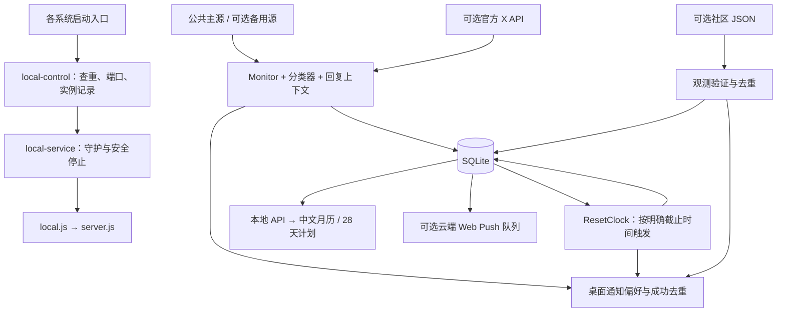

# Tibo Reset Live 开发交接（给 Claude）

> 功能交接日期：2026-10-25；版本与提交状态核对：2026-10-26，Asia/Shanghai。本文对应本地版本，不等于 GitHub 已发布的版本。
>
> 当前代码基线：`main` / `a5a333c`（补齐预告到点触发模块及相关测试）。来源配置、预告到点和 R1/R2 修复均已完成本地提交，不再是 23 个未提交路径。当前 `origin/main` 指向 `b756fbd`，本地领先 3 个提交；最近远程查询也为 `b756fbd`，尚未推送。本轮在该提交基础上新增自启目录保留、停止路径防护、时区/触发依据文案和回归测试；当前共 13 个未提交路径（12 个修改、1 个新增）。后续以实时 Git 状态与远程查询为准。
>
> 最新功能：有明确截止时间的官方重置预告会由后台到点自动触发日历、狂欢、人物恢复和提醒，无需等待第二条 `Done`；证据明确标为“按官方预告时间触发”。**R1、R2、R4 已修复；R3 已做代码修复，尚待真实登录验收；R5 已加防护但实执行验证被系统策略阻止。** 本轮 Node 测试共 99 项：98 通过、0 失败、1 跳过；到点时钟与本机模式两组浏览器检查已重跑通过，其他浏览器检查仍是前轮记录。

## 1. 先读这里

项目是供用户从 GitHub 下载、自行在电脑上运行的中文 Codex 额度重置日历。作者不提供公共后台。默认不登录 X，不使用 Cookies、Token 或 Telegram；本机后台读取第三方公开 JSON，再通过操作系统发送桌面通知。关闭网页后后台继续工作；电脑关机、休眠、断网时不能实时监测。

当前代码已具备三平台启动入口、用户数据目录、后台守护、免登录轮询、主备源机制、逐源状态、来源配置面板、28 天计划、预告到点时钟和人物五阶段。跨日功能归日与桌面通知失败重试已修复并有回归测试；本轮修复自启目录继承并为 Windows 停止路径加防护，仍需真实登录与受策略限制的脚本实执行验收，详见第 9 节。

接手时以当前本地提交为代码基线，另保留可能新增的未提交改动、`.env`、用户数据库和偏好；先确认差异，不要用 GitHub 的旧版本覆盖本地代码。提交、推送由用户决定。

## 2. 版本基线与审阅范围

| 项目 | 当前情况 |
| --- | --- |
| 本地目录 | `C:\Users\Administrator\Desktop\weixin\tibo-reset-live` |
| 远程仓库 | <https://github.com/yurenpai/tibo-reset-live> |
| 分支 / HEAD | `main` / `a5a333c` |
| HEAD 描述 | `补齐预告到点触发模块及相关测试` |
| 远程状态 | 当前 `origin/main` 为 `b756fbd`；本地领先 3 个提交，尚未推送，后续以实际查询为准 |
| 运行环境 | Windows，Node.js `v24.21.0`，npm `11.19.0` |
| 声明支持的 Node | `^24.15.0 || >=26.0.0`，不是任意 24.x 或 25.x |
| 当前工作区 | 本轮 12 个已有文件修改、1 个新增测试，共 13 个路径；均未暂存，提交前核对实时 Git 状态 |
| 暂存区 | 空；`a5a333c` 及之前改动已提交，本轮自启/提示改动尚未提交 |

审阅覆盖项目自己的后端、前端、CSS、启动与自启脚本、测试、种子资料结构、依赖声明、Docker 和 CI 配置。初次审阅基线曾包含 87 个非忽略文件，后续新增来源配置模块与测试；不要用这个历史数量判断当前是否漏文件。没有逐行审计 `node_modules`、第三方依赖源码、图片二进制、私有 `.env` 和用户数据库，也没有在本轮重新向 X 核验全部历史资料。

另一会话修改已纳入：公共主备源、每条来源健康状态、社区源独立重试/取消/去重、频率设置和来源提示；最后出现的 `tests/browser/source-qa.cjs` 也已审阅并通过。

## 3. 产品规则：后续修改不能破坏

1. **有明确截止时间的预告到点自动触发。** 截止前持续显示“重置已宣布”；到点生成独立 `timed` 记录，自动进入狂欢、人物恢复和提醒，不要求第二条 `Done`。没有明确截止时间时继续等待。
2. 官方完成、社区观测、未来预告、重置卡、功能发布分开。`banked` 是卡，不是自动到账；即使其 `status` 为 `confirmed`，确认的也只是卡。
3. `confirmed` 表示分类器认为原文是官方完成陈述；若经公共镜像收录，仍需保留 `via`，不能宣称本项目通过官方 API 独立验证过原文。社区观测始终标明不是 Tibo 官方确认，也不保证每个账号均已到账。
4. 默认看重置；另有“28 天计划”和“全部动态”。页面筛选与通知偏好独立，切换视图不能偷偷开启功能通知。
5. 默认通知类别为“官方确认 / 预告到点”和社区观测；预告/重置卡、功能、每日摘要默认关闭。还需用户主动开启本机通知总开关。
6. 官方确认或预告到点后完整狂欢 24 小时，社区观测使用轻庆祝。人物按距最近触发/完成记录的实际时间进入 Day 1–Day 5，第五阶段封顶。未到点预告、发卡和功能不能恢复清晰人物。外观预览不修改真实记录。
7. 28 天计划为 **2026-10-05 至 2026-11-01，按 PT（`America/Los_Angeles`）日期**；月历按北京时间。11 月 1 日 DST 结束，当地日长 25 小时，不能固定加减 24 小时。
8. “已进行 N/28 天”是时间进度；“未收录”不代表当天没更新；计划条目颜色或声明不能生成官方重置完成次数。
9. 首次读取和历史回填静默，不群发旧通知。本机恢复后补算已经到点的预告，仅提醒最近 6 小时的新事件；事件 ID、桌面待发队列和成功去重都跨重启保留。
10. 当前免登录路径是分钟级定时检查，第三方也可能延迟、遗漏或中断；不能对外描述成 X 发帖后秒级必达。

## 4. 技术结构与数据流

Node 原生 ESM + Express 5 + `node:sqlite`，前端是原生 HTML/CSS/JavaScript，无打包框架。SQLite 开启 WAL。运行依赖为 `express`、`web-push`、`node-notifier`。



### 后端模块

| 文件 | 作用 / 修改时关注点 |
| --- | --- |
| `src/server.js` | 历史种子、Express API、静态页、安全头、ResetClock、Web Push 投递、PT 18:00 每日摘要、停止流程 |
| `src/local.js` | 本机入口，强制本机模式、绑定 `127.0.0.1`、匹配 localhost Origin |
| `src/local-service.js` | 用户级守护，工作进程退出后退避重启，最长约 30 秒；令牌校验停止，等待子进程退出 |
| `src/paths.js` | 项目与数据目录、旧库迁移；本机和云端默认路径不同 |
| `src/public-feed.js` | 免登录解析、频率预设、ETag、主备切换、逐源冷却、游标、休眠恢复补查 |
| `src/source-config.js` | 本机来源配置验证、私有文件原子保存、采集器热切换、草稿只读连接测试、Token 脱敏返回 |
| `src/monitor.js` | 串行处理、作者过滤、父帖上下文、多层回复合并；可选官方 API 流与补漏 |
| `src/classify.js` | 否定/预告/完成/发卡/功能分类、事件规范化、Web Push 订阅地址校验 |
| `src/store.js` | SQLite 表与持久化、事件和帖子去重、Web Push 投递队列 |
| `src/reset-clock.js` | 旧误判修复、明确截止时间扫描、稳定 `timed-<预告ID>` 事件、首次静默与六小时补提醒 |
| `src/desktop.js` | `node-notifier`、通知偏好、系统支持检查、6 小时过滤、持久失败重试队列和成功去重 |
| `src/observations.js` | 社区 JSON 验证、逐源状态与退避、取消请求、跨源同凭据去重 |
| `src/plan.js` | 28 日骨架、事件归日、静态与动态内容合并、统计；见 R1 |
| `src/preferences.js` | 所有通知类型的统一判定；重置卡归预告开关 |
| `src/schedule.js` | IANA 时区、PT 观察窗口、PST/PDT 字面触发时间；重置卡时间不进入 ResetClock |

### 前端与布局

| 文件 | 职责 |
| --- | --- |
| `public/app.js` | 月历、筛选、详情、通知和频率表单、主题更新；每 20 秒请求本机 API |
| `public/plan-ui.js` | 28 天网格、统计、详情、数据表与来源；刷新时保留操作焦点 |
| `public/source-status.js` | 来源总览、逐源卡片、主备切换、未配置提示、社区通知说明 |
| `public/source-config.js` | 配置表单、草稿保护、连接测试、保存立即应用、恢复默认草稿；不使用浏览器存储保存 Token |
| `public/content.js` | 前后端共享的内容可见性与日期工具 |
| `public/theme.js` | 真实/预览人物阶段、预告与庆祝状态的纯计算 |
| `public/sw.js` | 可选 Web Push 展示与通知点击，同源地址限制 |
| `public/index.html` | 中文页面结构、脚本与样式入口 |

CSS 加载顺序：`style.css → festival.css → mascot.css → evidence.css → plan.css → local.css → source-settings.css`。`local.css` 与 `source-settings.css` 有重复的来源/频率样式；覆盖还取决于选择器优先级，后文件并非必定胜出。当前自动浏览器检查未发现这些模块在测试宽度下横向溢出，尚未做逐像素人工设计验收。后续改布局建议收敛重复规则，保留手机布局、展开状态、焦点和减少动态效果。

`public/assets/` 人物素材及 `docs/images/` 截图另有来源说明；代码 MIT 许可不代表取得图片的再分发授权，见 `public/assets/README.md`。

## 5. 来源：已经实现什么，尚未接入什么

### 公共帖子源

默认主源为 <https://codex-reset.com/api/feed>。只取原帖 ID、原文、发布时间、账号、链接、回复父帖信息；**不导入上游的 confirmed、评分或运营者判断**。本项目再做分类，并标注“公共镜像收录 · 未独立核验”。

需要的结构：`profile.handle`、`fetched_at`、`tweets[]`；帖子包含 `id/url/at/text`，回复还需 `is_reply/in_reply_to_tweet_id`。账号必须匹配，链接和 ID 必须一致。最多处理前 200 项，响应上限 2 MB；上游检查时间落后 15 分钟或标记 stale 则视为过期，保留记录但不发新通知。

`PUBLIC_FEED_FALLBACK_URLS` 支持最多两个备用 HTTPS 地址，不能含 URL 凭证。主源正常不请求备用；失败、限流、格式错误或过期后依次尝试。各源独立 ETag、缓存、失败次数和冷却；主源冷却结束后优先重试，恢复后切回。同一 X 帖子跨源仍按帖子 ID 去重。

**默认实际只有一个公共源；备用机制可用，不代表存在已验证的第二个服务。** 另一会话的候选核查见 [source-review.md](source-review.md)。其中记录了接口冲突和独立性问题，不能把同源转述算作多份独立证据。该文档的外部探测结果不是本轮重新联网验证的结果。

频率：`smart` 平时 300 秒，最近 48 小时有未落地新预告则 120 秒；`fast` 120 秒、`standard` 300 秒、`saver` 900 秒。约 ±10% 错峰，最短 120 秒，普通失败退避最长约 1800 秒；上游 `Retry-After` 可以要求等更久。48 小时只是加速检查期限，**不是撤销预告的期限**。页面每 20 秒刷新不会额外请求上游。

首次成功读取建立基线；后续仅对新 ID 通知，旧帖补录静默。过期数据不推进成功游标。逐源健康信息目前主要在内存中，进程重启后重新检查；历史事件、游标和设置持久化，不能将两者混为一谈。

### 社区观测源

`OBSERVATION_SOURCES` 默认留空。页面开启“社区观测提醒”不等于自动接入社区数据，也不能凭空观测用户自己的额度。本机已新增页面 URL 编辑器，社区源每行一个、最多五个，保存立即生效；云部署仍使用环境配置。

接口为数组或 `{ observations: [...] }`，条目至少有 `id/at/url`，可带 `note/scope`。只接受最近 7 天内、最多未来偏差 5 分钟的可核对记录，每次最多检查前 50 项；来源地址要求 HTTPS 且无凭证。事件 ID 加 `observed-` 前缀，保留原凭据和 `via.type=community-feed`。

各社区源分别显示最近检查、成功、失败、下次检查和有效记录数；默认约 5 分钟，失败逐级退避并遵守各自 `Retry-After`，一个源失败不阻塞另一个。停止会中止请求；重复调用不并发。跨源同 `url + at + scope` 的观测不重复提醒，即使提供方 ID 不同。

目前没有经过核实、默认可用的社区实时 JSON 服务。空数组可以表示检查成功但没有有效观测；非空响应全不合格会显示错误，不伪装成功。

### 官方 API 和云端路径

`SOURCE_MODE=auto` 有 Token 选官方、无 Token 选公共；`public` 固定公共，`api` 固定官方。公共模式解析父帖只查当前批次/本地上下文，不偷偷调用需要 Token 的官方 API。

官方模式首次回填最近 10 条且静默；之后实时流和每 120 秒时间线补漏，保留本人回复，过滤转推。需要用户自己的 X Developer App 和相应权限，可能创建过滤流规则。页面测试只读账号查询，不创建规则，不代表完整权限验收；保存为官方模式后才启动正式采集。R4 已修复，但仍没有真实 X 端到端验证。

云端 `npm start`、Docker、VAPID/Web Push 仍保留。它们是可选的用户自部署方式；不能据此承诺本地电脑关机后仍可通知。Web Push 有数据库投递队列，与桌面通知机制不同。

## 6. 启动、自启和持久化

| 系统 | 启动 | 启动并设置登录自启 | 停止 | 取消以后登录自启 |
| --- | --- | --- | --- | --- |
| Windows | `start.cmd` | `scripts/launchers/start-service.cmd` | `stop.cmd` | `scripts/launchers/disable-autostart.cmd` |
| macOS | `start.command` | `scripts/launchers/start-service.command` | `stop.command` | `scripts/launchers/disable-autostart.command` |
| Linux | `sh start.sh` | `sh scripts/launchers/start-service.sh` | `sh stop.sh` | `sh scripts/launchers/disable-autostart.sh` |

Windows `scripts/start-local.ps1` 必要时下载官方便携 Node 24 并校验 SHA256，安装依赖后交给统一控制器。Unix `scripts/start-unix.sh` 要求预装兼容 Node/npm，补充常见 Homebrew PATH，依赖变化时执行 `npm ci`；尚未做 Node 自动下载。

`scripts/local-control.mjs` 加载 `.env`，支持 `start/stop/status/open`：文件锁、默认 8788–8808 端口探测、后台实例记录、健康检查、浏览器打开和安全停止。发现已有存活但暂不健康的后台时，不会盲目再开一个。`src/local-service.js` 是用户进程守护，**不是管理员安装的 Windows Service**。

自启：Windows 当前用户 Startup 快捷方式；macOS LaunchAgent；Linux 优先图形会话 systemd 用户服务，不可用则 XDG autostart。普通启动不会自动写自启项；取消自启设计为不停止当前实例。路径移动后需重新配置；真实登录恢复仍需对应平台验收。

`npm run local` 是直接启动前台，关闭终端就停止；它不受统一控制器管理，`local:status/local:stop` 不能当作管理任意前台进程的工具。本机只监听 `127.0.0.1`，不面向局域网，修改接口需要准确匹配 localhost Origin；不要随意把绑定改成 `0.0.0.0`。

### 数据位置

| 模式 / 系统 | 默认位置 |
| --- | --- |
| Windows 本机 | `%LOCALAPPDATA%\TiboResetLive` |
| macOS 本机 | `~/Library/Application Support/TiboResetLive` |
| Linux 本机 | `$XDG_DATA_HOME/tibo-reset-live`，无此变量则 `~/.local/share/tibo-reset-live` |
| 云端 | 项目 `data/`；Docker 挂载 `/app/data` |
| 显式覆盖 | `TIBO_DATA_DIR` 优先；相对路径从项目根解析 |

SQLite `calendar.sqlite` 的表：`posts`、`events`、`subscriptions`、`deliveries`、`desktop_deliveries`、`meta`。`deliveries` 是 Web Push 队列；`desktop_deliveries` 是本机系统通知的持久待发队列，失败后指数退避，最多 8 次，并受六小时有效期和最新偏好约束。

主要 meta 键：`desktopSettings`、`desktopSent:<eventId>`、`resetClockInitialized`、`resetScheduleRepair:v1`、`publicPollMode`、`publicFeedInitialized`、`publicFeedCursor`、官方 `cursor`、`lastCheck`、`observationCheck`、`observationError`。事件正文为 JSON，保留 `topic/evidence/status/kind/parent/followUps/via` 等；预告到点使用稳定 ID `timed-<预告ID>`，混合帖功能事件使用 `<原帖ID>-feature`。

实例文件包括 `local-instance.json`、`local-service.json`、`local-stop.json`、`launcher.lock`，以及日志和迁移记录。令牌用于停止握手，不能公开复制这些运行文件。另有来源配置 `local-sources.json`：保存完整来源及明文 API Token，Unix 权限 `0600`，Git/Docker 忽略，不应分享。此文件不随数据库迁移/清理而重写；删除它会恢复环境中的来源配置。日志目前没有轮转，属于后续维护事项。

升级旧版时先停止旧后台，再由 SQLite `VACUUM INTO` 建一致快照，包含已提交 WAL；不会直接裸拷贝 sqlite/wal/shm。目标已存在则不覆盖，旧库保留；检测到已知旧后台存活时拒绝迁移。迁移发布用硬链接避免覆盖，实际文件系统兼容性仍值得真机验证。

## 7. 配置与 API 速查

| 配置 | 说明 |
| --- | --- |
| `PORT` | 默认 8788；双击启动器可另选空闲端口 |
| `TIBO_DATA_DIR` | 用户数据目录；显式设置优先，其次使用自启时记住的数据目录；见 R3 |
| `SOURCE_MODE` | `auto/public/api` |
| `X_BEARER_TOKEN` / `X_HANDLE` | 官方路径凭证与账号，默认账号 `thsottiaux` |
| `PUBLIC_FEED_URL` | 主帖子 JSON 地址 |
| `PUBLIC_FEED_FALLBACK_URLS` | 最多两个备用，逗号分隔，默认空 |
| `PUBLIC_POLL_MODE` | `smart/fast/standard/saver`；数据库已保存选择优先 |
| `PUBLIC_POLL_SECONDS` | 旧配置兼容，映射到安全预设，不是任意秒数 |
| `OBSERVATION_SOURCES` | 社区 HTTPS JSON 地址，逗号分隔，默认空 |
| `PUBLIC_ORIGIN` | 云端外部 HTTPS Origin；本机入口使用所选 localhost Origin |
| `VAPID_PUBLIC_KEY/PRIVATE_KEY/SUBJECT` | 可选云端 Web Push；私钥持久保存，不每次重生成 |

| 接口 | 用途 |
| --- | --- |
| `GET /api/health` | 应用标识、健康、本机模式信息 |
| `GET /api/calendar` | 事件、计划、帖子源状态、逐社区源状态、通知信息 |
| `POST /api/local/preferences` | 保存本机通知总开关和类别 |
| `POST /api/local/test-notification` | 调用系统测试通知，不写重置事件 |
| `POST /api/local/source-settings` | `{pollMode}` 保存预设；不支持随意秒数或地址 |
| `GET /api/local/source-config` | 本机地址、模式与 `tokenConfigured`；不返回 Token |
| `POST /api/local/source-config` | 保存完整来源表单，立即切换；Token 留空保留、`clearToken` 清除 |
| `POST /api/local/source-config/test` | 仅测试当前草稿，不保存、入库或通知；结果允许部分失败 |
| `POST /api/subscribe` | 可选 Web Push 订阅 |
| `POST /api/preferences` | 可选 Web Push 订阅偏好 |
| `POST /api/unsubscribe` | 取消订阅和相关投递 |

非 GET API 检查准确的 Origin，并按 IP 限制每分钟 30 次写操作；JSON 上限 8 KB。本机控制接口在没有桌面模块的云部署中不可用。已有 CSP、nosniff 等安全头；这不等于完成公网部署安全审计。

### 本机来源配置：实现细节与验收要点

- 入口：`数据来源与后台状态 → 配置数据来源 · 免登录 / 官方 API`。旧后台升级后必须重启一次才有新接口；此后换源无需重启。云部署不开放面板对应 API。
- 启动关系：本机 `startServer` 创建 `SourceConfig`，将它作为 monitor 的外观对象传给 `createApp`；`status`、轮询设置和社区状态始终转发到当前采集器。云部署仍直接使用环境构造原 Monitor/Observations。
- 配置字段：`mode`（仅 `public/api`）、`publicFeedUrl`、`fallbackUrls[]`、`observationSources[]`、`token`。对外视图去掉 `token`，只给出 `tokenConfigured`。保存表单接受额外布尔 `clearToken`，它不是持久字段。
- 优先级：已保存的本机来源文件 > 环境来源设置 > 内置默认；尚未保存文件时兼容 `SOURCE_MODE=auto`。轮询频率仍由 SQLite 的 `publicPollMode` 单独管理，不属于此文件。
- 密钥留空保留、填写替换；清除需要免登录模式。保存后的空 Token 会覆盖环境中的旧 Token，不会在重启时意外恢复。恢复默认只先填草稿，保存后明确清空 Token、备用和社区，不重新导入 `.env`。
- 保存顺序：校验 → 构造新采集器 → 以临时文件原子保存 → 停止旧采集器并推进代次 → 启动新采集器。写入失败保留旧配置；代次检查拦住旧回调，原采集器自身也检查停止状态。不要删游标或重置通知去重来实现换源。
- 连接测试读取草稿，最多并行测试一个主源、两个备用和五个社区源；同一配置管理器拒绝重叠测试。响应上限 2 MB、请求超时约 15 秒。测试不修改文件、数据库或通知状态。
- 官方测试只读 `users/by/username`，不创建流规则；Token 只发向固定的官方 API 域名，公共/社区接口不会附带它。HTTP 成功也要检查有效数据；不要把官方账号查询成功写成流权限验证成功。
- 前端只在展开时加载配置，20 秒日历刷新不覆盖草稿。测试与保存进行时禁用控件，防止同页重复操作。模式切换是应用 Token 配置，不是 X 账号网页登录。
- 异常恢复：损坏的本机来源文件会报错并保留原文件，不静默覆盖。修复前先保存私有备份；重命名/移走该文件会恢复环境来源设置。不要上传文件内容给 Claude 或 GitHub，尤其不要复制真实 Token。
- 用例入口：`node --test tests/source-config.test.js` 与 `node tests/browser/source-config-qa.cjs`。后者使用模拟官方采集器，不能作为真实 API 权限或公网验收凭据。截图在 `.artifacts/qa/source-config-desktop.png` 和 `source-config-mobile.png`，不随 Git 分发。

## 8. 已完成的验证及限制

| 验证 | 结果与范围 |
| --- | --- |
| `npm test` | 本轮 **99 项：98 通过、0 失败、1 跳过**；新增自启目录/密钥不继承、目录记录恢复、通知磁盘数据库关闭重开回归。Windows 停止脚本实执行因 Restricted 策略跳过，不视为通过 |
| `npm run test:local` | 本轮重跑通过：来源未配置/失败提示、频率保存恢复与草稿、预告持续/完成狂欢、后台通知模拟去重、三视图手机布局等 |
| `qa.cjs` | 隔离的内存数据库、种子与固定后端时间下通过：月历边界、三视图、计划/双时区/统计/偏好、来源隔离、桌面和手机布局 |
| `festival-qa.cjs` | 同一隔离夹具下通过：狂欢、第五阶段、预览退出、人物收起、手机与减少动态效果 |
| `node tests/browser/source-qa.cjs` | 通过：主源 429 后备用状态、独立冷却、社区部分 503、未使用备用状态、手机来源卡片无横向溢出 |
| `node tests/browser/source-config-qa.cjs` | 通过：草稿与测试隔离、公共/官方模式切换、Token 不回显、保存失败保留、移动布局、默认恢复、关闭页面通知和重启恢复去重；官方连接使用模拟器 |
| `node tests/browser/reset-clock-qa.cjs` | 本轮重跑通过：11:39 宣布与 16:00 触发分开显示、关页后台通知、到点狂欢、人物 Day 1、PT Day 20、手机布局和重启去重 |
| 脚本语法 | PowerShell AST 解析、Unix `sh -n` 均通过 |
| Windows 实际启动 | 此前开发阶段用临时数据目录验证启动、重复启动、查询与停止；本轮最终 Node 测试也验证共享控制器生命周期。没有再次改动用户当前自启项 |
| R1/R2/R4 回归 | 均已修复并通过正式测试；R3 代码修复与生成器回归通过但未真实登录验收；R5 防护已改，实执行仍受系统策略限制 |

**尚未证明的内容：** macOS/Linux 真实通知权限、登录自启、睡眠恢复；真实官方 X API 流；公网 HTTPS Web Push；Docker 构建运行；GitHub Actions 的远程结果。CI 配置已写三系统矩阵，但本轮没有读取实际运行结果，不能称为远程三平台验收完成。CI 主要测 Node 与脚本，并不等于操作系统弹窗验收。

### 接手后如何复跑

从项目根运行，先确认 Node 版本与当前工作区：

```sh
git status --short
git diff --stat
node --version
npm ci
npm test
```

浏览器脚本依赖 Playwright，但它目前没有列进开发依赖；临时安装会被后续 `npm ci` 清除：

```sh
npm install --no-save --package-lock=false playwright
npm run test:local
node tests/browser/source-qa.cjs
node tests/browser/source-config-qa.cjs
node tests/browser/reset-clock-qa.cjs
```

现有脚本默认查 Windows Chrome；`qa.cjs/local-qa.cjs/source-qa.cjs` 可设置 `CHROME_PATH`，`festival-qa.cjs` 仍写死 Windows Chrome，属于跨平台测试待补项。不要因为 Node 的三系统测试存在，就认为浏览器脚本也跨平台。

`test:ui` 和 `test:festival` 需要先有服务器，可用 `QA_BASE_URL` 指定；它们依赖特定历史日期和种子，不宜直接对随时变化的生产数据运行。本轮使用 `Store(':memory:')`、`seedHistoricalEvents`、固定 `now=2026-10-23T09:30:00Z`、随机本地端口的 `createApp`，以异步子进程运行这两个脚本。不要同步阻塞夹具服务器的 Node 事件循环。

本机初次复核辅助程序在 `.artifacts/handoff/browser-review.mjs` 和 `review-repros.mjs`；该目录被 Git 忽略，**不会随仓库交接**，不能当成正式测试。前者仍可用固定夹具复跑主 QA 与狂欢 QA。R1/R2 的正式回归在 `tests/handoff-regressions.test.js`，R4 在 `tests/source-config.test.js`，到点规则在 `tests/reset-clock.test.js` 与 `tests/browser/reset-clock-qa.cjs`。

真机测试请另设临时 `TIBO_DATA_DIR` 并关闭旧库迁移，例如设置 `TIBO_SKIP_LEGACY_MIGRATION=1`；只停止该临时实例。不要清空默认用户数据目录、冒用用户真实订阅、向真实系统批量发测试消息。

## 9. 审阅发现：待修复问题

以下编号保留初次审阅上下文。R1、R2、R4 已修复并有正式回归；R3 代码已修复，仍需真实登录验证；R5 已做目录选择防护，但尚未端到端确认。

### R1 · 已修复：功能回复被归入父帖旧日期

修复说明：功能事件现在先按自身发布时间归 PT 日；只有重置证据沿原预告归日。`tests/handoff-regressions.test.js` 覆盖跨日、同日混合主题、跨日完成证据和循环父帖。

- 位置：`src/plan.js:35`，`buildPlan` 内 `eventDay`。
- 原因：所有事件都先沿 `parent` 找计划日，没有先排除功能事件；`monitor.js` 恰好会为功能回复保留 `parent`。
- 最小情景：Day 1 的 reset 预告 `p` 时间 `2026-10-05T20:00:00Z`；其下 Day 2 的功能回复 `f` 时间 `2026-10-06T20:00:00Z`，`topic/kind=feature`、`parent=p`。`dayOf(f.at)` 得到 2，`buildPlan` 却把 `f` 放在 1。
- 影响：功能日、标题与统计可能串日；现有“按 PT 日期而非 planDay”的测试没有跨日父帖，未覆盖此问题。
- 建议：功能先按自身时间归 PT 日；仅为需要关联原预告的重置证据保留父帖归日。不要全局删除父帖逻辑。
- 验收：同日与跨日功能回复、混合帖、跨日 Done 重置关联、循环父帖全部覆盖；修复不能把功能发布时间移动成父帖时间。

### R2 · 已修复：桌面通知临时失败后不会自动重试

修复说明：新增 `desktop_deliveries` 持久队列，失败按上限退避，启动和每 30 秒检查；发送前重查偏好、六小时有效期和成功去重。关闭对应偏好会移除待发项，成功标记与删除在同一事务中完成。`tests/handoff-regressions.test.js` 覆盖失败后重启恢复、只发一次、关闭偏好和过期清理。

- 位置：`src/desktop.js:43` 的 `event`，结合 `src/public-feed.js` 的成功入库/游标推进。
- 复现：内存 Store 开启桌面提醒，mock `send` 抛临时错误。先成功建立帖子 `100` 基线，再加入新完成帖 `101`，连续检查两次并等待 `desktop.chain`。发送调用只有 1 次；`publicFeedCursor=101`，`desktopSent:101` 未写入，错误保留，但后续不重试。
- 原因：桌面只在内存 Promise 链里尝试；失败被捕获，事件/帖子却已保存，下轮去重跳过，不会再次触发 `event`。重启也没有待发任务扫描，最后错误状态还是内存态。
- 影响：系统通知组件暂时异常时，页面有记录但用户错过弹窗。Web Push 的 `deliveries` 不解决本机路径。
- 建议：为桌面建立可持久化、有次数与退避上限的待发队列；发送时重查偏好和 6 小时有效期，成功后持久去重。首次基线、旧回填和关闭偏好不得进入补发。
- 验收：先失败后恢复可重试；重启后仅补仍有效待发；关闭偏好取消；多次上游轮询/主备切换不重复。系统接口返回接受不代表用户已看见，超时后的最终送达也要考虑去重策略。

### R3 · 代码已修复，待真机登录验收：自定义数据目录继承

本轮修复：统一控制器新增只读 `data-dir` 与 `remember-data-dir` 操作，自启仅把绝对数据目录保存到项目 `.runtime/autostart-data-dir.json`，不复制 Token 或完整环境。普通启动、查询、停止共用该回退目录；显式环境与 `.env` 优先。Unix 自启配置另显式保留 `TIBO_DATA_DIR`。Windows 的“启动并自启”先准备 Node 与后台再注册，注册使用统一控制器记录目录。取消自启保留该目录记录，避免停止/查询切回另一库；如需更换，用显式 `TIBO_DATA_DIR` 重新启动/注册，或停机并备份后管理该记录。生成器、特殊字符、密钥不复制与目录重读测试通过；没有修改当前用户真实自启项或执行登出/登录。以下保留原始问题记录：

- 位置：`scripts/autostart.mjs:12` 起的 `macAgent/linuxUnit/linuxDesktop`。
- 复现：给三个生成器传入 `{env:{PATH:'/usr/bin', TIBO_DATA_DIR:'/tmp/custom-calendar'}}`，生成结果均不含自定义数据目录，只持久化 PATH。
- 条件：用户只在当前终端设置 `TIBO_DATA_DIR` 后启用自启，而没有写入 `.env` 或系统持久环境。
- 影响：下次登录可能改用默认目录，看起来像历史和偏好丢失；实际旧库可能仍在另一目录。生成配置层已复现，真实登出/登入尚未验收。
- 建议：持久化经过解析的目录，或明确要求自定义目录写入 `.env` 并在设置自启时提示。Windows 快捷方式也有临时环境不继承的同类静态风险，尚未真机复现。
- 验收：启用 → 登录恢复 → status → stop 全程使用同一目录，覆盖空格和特殊字符；不能复制凭证等无关环境变量进自启配置。

### R4 · 已修复：官方 API 初始化退避时停止，等待后还会再请求

修复说明：`Monitor` 加入生命周期 AbortController，API 请求与退避等待可取消；入口、异步返回和入库前检查停止状态。动态换源停止旧采集器后，迟到响应不会继续初始化或写入。`tests/source-config.test.js` 分别覆盖退避中停止和请求中停止；下列为原始问题记录。

- 位置：`src/monitor.js:95` 的 `start` 及其 catch 中 60 秒等待。
- 复现：mock `api` 始终失败，mock `node:timers/promises.setTimeout` 为可控 Promise；第一次失败进入等待后执行 `stop()`，再释放等待。`api` 总调用次数为 2，而不是 1。
- 原因：等待前判断 `!stopped`，等待后直接递归 `start()`；入口没有停止保护。
- 影响：停止后仍可能重新初始化或创建补漏定时器；属于可选官方路径，不是当前默认公共轮询停止问题。
- 建议：可取消等待，入口与关键 await 后检查停止状态，保证停止后不再请求或创建定时器。
- 验收：初始化、回填、规则读取、退避期间分别停止；确认无额外请求、无新 interval，并且正常重连不受影响。

### R5 · 已加防护，实执行未验收：Windows 新旧停止路径目录选择

本轮防护：`stop-local.ps1` 先调用统一控制器 `data-dir`，由 Node 加载 `.env` 并解析自启目录记录，再读取实例账本。自定义目录或仍有守护记录时不回退到项目旧库。原身份校验保留，未按进程名批量停止。`tests/autostart-directory.test.js` 包含隔离临时目录的新旧账本测试，但本机 PowerShell 策略为 Restricted，该项自动跳过；不绕过或修改策略，因此不能声称已完成端到端复现/验收。以下保留原始风险记录：

这是代码审阅推断，**未端到端复现**，不要当作已证实故障。`scripts/stop-local.ps1:3` 在调用共享控制器前先根据终端环境/默认目录找记录，没有在这一步加载 `.env`；若 `.env` 指定新目录、项目 `data/` 恰好残留带 `startedTicks` 的旧记录，可能提前走旧停止分支，没停到新目录的实例。

建议构造隔离的新旧账本测试；优先让共享控制器统一解析路径，再谨慎进入旧版兼容分支。不要为修复此风险按名称杀全部 Node 或删除用户旧库。

## 10. 本次预告到点与回归修复的文件清单

本清单是相对于 `12ba95a` 的历史开发范围：19 个已有文件修改、4 个新文件，共 23 个路径。它们现已进入 `057bf76` 与 `a5a333c` 两个本地提交，不是当前未提交清单；来源配置功能已在 `12ba95a` 中，不应重复描述为本轮新增。

| 本地提交 | 内容与依赖 |
| --- | --- |
| `12ba95a` | 来源配置、即时切换与密钥保护 |
| `057bf76` | 预告到点相关页面与分类、R1/R2 修复及部分测试 |
| `a5a333c` | 补齐 `reset-clock.js`、截止换算、服务接入、存储方法及到点测试 |

后两个提交共同构成完整功能：`057bf76` 的桌面模块已调用当时尚未提交的 Store 队列方法，直到 `a5a333c` 才补齐。不要单独删除补齐提交，也不要将中间提交当作独立可用版本。当前完整代码基线为 `a5a333c`。本次文档同步不改写提交历史；推送前核对实际暂存清单。

| 路径 | 本次变化 |
| --- | --- |
| `src/reset-clock.js`（新增） | 旧数据修正、明确截止扫描、稳定到点事件、首次静默、六小时补提醒和持久去重 |
| `tests/reset-clock.test.js`（新增） | 8 项到点、时区、回复合并、重启、偏好、卡片隔离、计划归日和旧数据修复测试 |
| `tests/browser/reset-clock-qa.cjs`（新增） | 11:39 / 16:00 分离、关页通知、狂欢、人物、PT 计划、手机布局及重启去重 |
| `tests/handoff-regressions.test.js`（新增） | R1 跨日功能归日与 R2 桌面通知持久重试回归 |
| `src/classify.js` / `src/schedule.js` / `src/monitor.js` | 识别预告及时间回复、计算 `triggerAt`、合并父帖；重置卡时间保持卡片语义 |
| `src/server.js` / `src/preferences.js` / `src/public-feed.js` | 启动到点时钟、摘要与通知偏好映射、到点后恢复普通检查频率 |
| `src/desktop.js` / `src/store.js` | 新增本机通知持久待发队列、退避、偏好/时效清理、事务去重 |
| `src/plan.js` | 到点证据与计数；修复功能回复跨日错误，同时保留重置证据沿父预告归日 |
| `public/app.js` / `public/theme.js` / `public/content.js` | 预告倒计时、到点狂欢与人物状态、宣布/触发时间分开展示、内容筛选 |
| `public/index.html` / `public/plan-ui.js` / `public/evidence.css` | 新图例、状态、统计、详情文案和到点样式 |
| `tests/browser/qa.cjs` | 更新明确截止时间的计划文案断言 |
| `README.md` / `docs/ADVANCED_ZH.md` / 本文 | 同步产品规则、数据结构、测试结果、已修复与遗留问题 |

根目录保留三平台 `start.* / stop.*`；7 个自启管理入口位于 `scripts/launchers/`，实际被系统自启引用的核心脚本路径未改变。不要把它们搬回根目录。

`.env`、`local-sources.json`、用户数据库、订阅、运行令牌、日志、`.runtime/`、`node_modules/` 和 `.artifacts/` 不提交。原子保存临时文件同样不提交。提交之前检查实际暂存清单，而不是仅依赖本文数量。

## 11. 给 Claude 的建议接手顺序

1. 阅读本文、README、来源核查；核对当前本地提交、工作区和远程状态。到点时钟与 R1/R2 修复已在本地提交，但当前 GitHub 版本尚未包含，不能混淆“已提交”“已推送”与“工作区干净”。
2. 保持 `tests/reset-clock.test.js`、`tests/handoff-regressions.test.js` 和专门浏览器验收通过；修改时间规则时必须同时验证 PST/PDT/PT、卡片隔离、重启补算和通知去重。
3. 真机验收 R3 的登录恢复；在允许运行脚本的隔离环境执行 R5 回归。保留 R1/R2/R4 及到点回归，不修改系统策略或真实用户数据来强行通过测试。
4. 保留来源诚实提示；未找到可信备用前不把候选网站接成自动到账来源。
5. 将 Playwright/固定日期夹具纳入可重复测试方案；再做 macOS/Linux 真机通知、自启与退出验收，最后查看真实 CI 结果。
6. 需要发布时先交付可审阅差异和验证记录，由用户决定提交推送。来源设置 UI 已完成；打包安装器、日志轮转及 X 账号 OAuth 登录属于后续选题，本次没有实现。

可直接复制给 Claude：

> 请先阅读 `docs/DEVELOPMENT_HANDOFF_ZH.md`，以本地完整提交 `a5a333c` 及其后的实际工作区为准，核对 Git 状态与远程版本，不要用远程旧代码覆盖本地功能或另一会话新增的改动。来源配置、到点时钟与 R1/R2 修复已完成本地提交；本次文档同步时尚未推送，后续以实际查询为准。当前规则是：官方预告给出明确截止时间后，到点自动触发日历、狂欢、人物恢复和提醒，不要求第二条 Done；证据显示“按官方预告时间触发”，宣布时间与触发时间分开。R1、R2、R4 已修复，请保持回归；R3 已修复但未真机登录验收，R5 已加防护但脚本实执行被系统策略阻止，请保留这些限制。保留来源配置面板与热切换、免 X 登录、本机自运行、重置卡隔离、官方/到点/社区证据区分、PT/北京时间以及用户数据迁移规则。不要清理用户数据库或擅自提交推送。完成后用中文说明改动文件、测试结果及仍未实测的平台限制。

## 12. 本轮增量交接（2026-10-26，未提交）

- 核实 Day 20 原帖：https://x.com/thsottiaux/status/2114200152701575656 ，原文 `Day 20/ Rest and reset`，北京时间 2026-10-25 11:39:31。
- 核实本人回复：https://x.com/thsottiaux/status/2114200291319124163 ，原文 `By midnight PST`，北京时间 11:40:04，父帖就是上述主帖。通过公共帖子接口定位，再经 FxTwitter 镜像核对作者、原文、父帖和时间；不声称官方 API 独立验真。
- 11:39 是宣布时间。按 PST 字面午夜是北京时间 10 月 25 日 16:00；洛杉矶该日实际 PDT 午夜是 15:00。维持现有按原文 PST 触发规则，详情明确标注两者，不把宣布时间当作到账。
- 页面新增北京时间归日标签、计划归属与跨日解释；计划详情显示本人时间回复。`timed` 明示“未检查个人账号额度，不是官方完成确认”，保留金色与彩屑。未配置社区源时明确勾选偏好不会接入数据或读取个人额度。
- 本轮文件：`scripts/autostart.mjs`、`scripts/autostart.ps1`、`scripts/launchers/start-service.cmd`、`scripts/local-control.mjs`、`scripts/stop-local.ps1`、`src/paths.js`、`public/app.js`、`public/index.html`、`public/plan-ui.js`、`public/source-status.js`、`tests/handoff-regressions.test.js`、新增 `tests/autostart-directory.test.js` 及本文。
- 验证：Node 98 通过/0 失败/1 跳过；`node tests/browser/reset-clock-qa.cjs`、`npm run test:local` 本轮通过；`git diff --check` 通过。没有重跑其他浏览器检查或真机登录，没有触碰真实用户数据库、自启项、凭证或后台，也没有提交推送。
- 未做：社区源首次接入/换源的静默基线策略尚需独立测试与实现，不应宣称所有通知首次回填路径都已覆盖；同一重置先到点后官方确认的跨证据提醒合并策略也未在本轮改变。系统通知超时后可能实际已展示，失败重试不能保证用户绝不看到重复弹窗。
